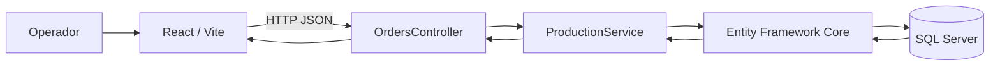
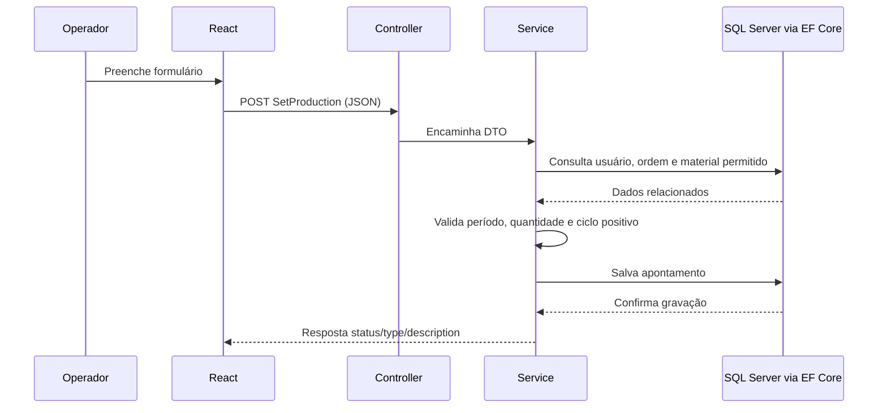

# Arquitetura

## Conceitos

- **API REST:** interface HTTP que oferece recursos por rotas e usa métodos como GET para consulta e POST para gravação. O projeto retorna JSON.
- **ASP.NET Core:** plataforma da Microsoft usada para criar a API em C# e hospedar rotas HTTP.
- **Entity Framework Core (EF Core):** biblioteca de mapeamento objeto-relacional. As classes C# representam tabelas e o EF gera consultas SQL.
- **ORM:** ferramenta que traduz operações entre objetos da aplicação e registros relacionais.
- **SQL Server:** banco relacional da Microsoft que armazena os dados de forma persistente.
- **Controller:** recebe requisições HTTP, chama o Service e converte o resultado em resposta HTTP.
- **Service:** concentra regras de negócio e validações do apontamento.
- **Model:** entidade persistida no banco, como Product, Order e Production.
- **DTO:** formato de entrada e saída da API. Evita expor entidades diretamente e documenta o contrato.

## Comunicação entre as partes

O front-end chama a URL configurada por `VITE_API_URL`. O CORS permite o endereço do Vite configurado em `Cors:Origins`.

## Fluxo de gravação

O Service verifica a existência do usuário e da ordem, o período cadastrado para o usuário, quantidade maior que zero e até o limite da ordem, associação do material ao produto e ciclo positivo. Ciclo menor que o padrão é aceito e informado na descrição. A quantidade acumulada não é validada conforme o enunciado. A migration cria esquema e índices; o inicializador insere registros de demonstração apenas se as tabelas correspondentes estiverem vazias.
